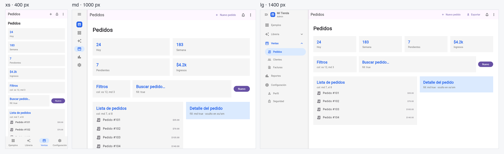
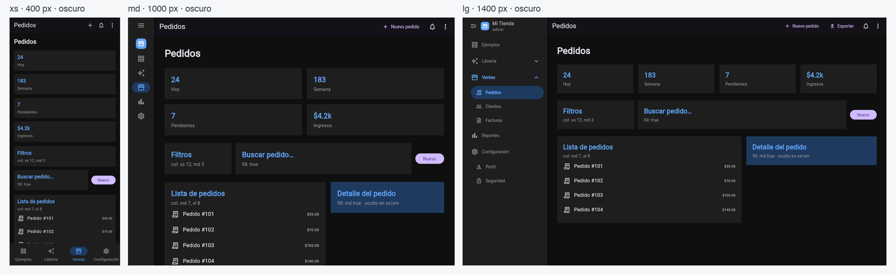
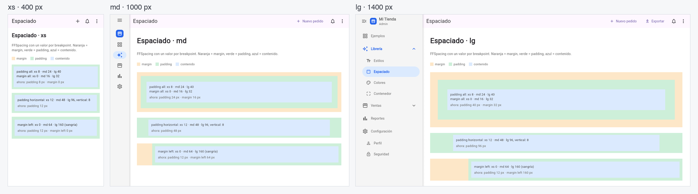
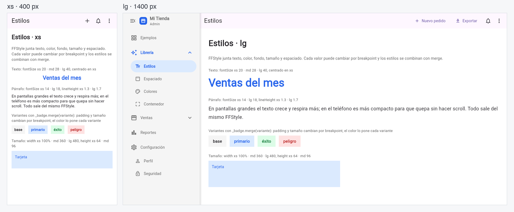
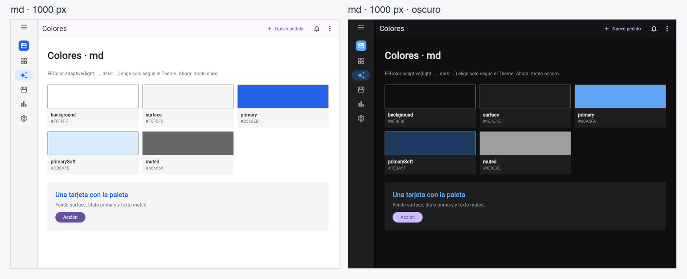
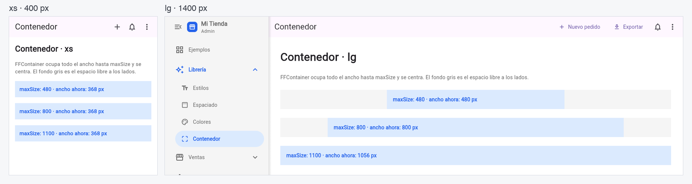
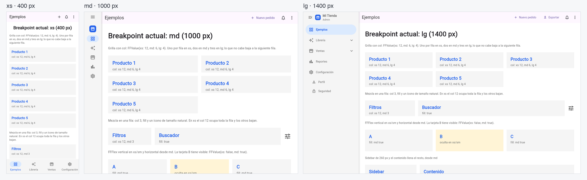
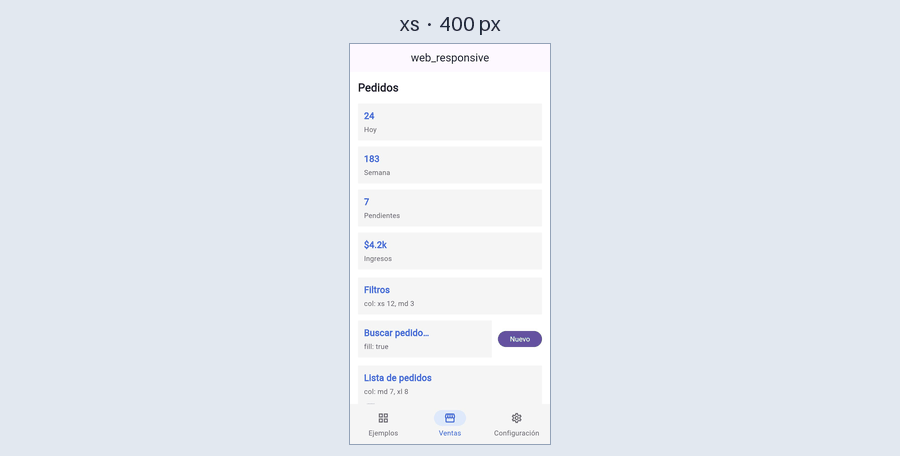
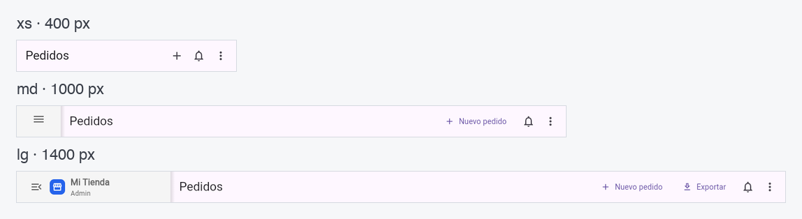
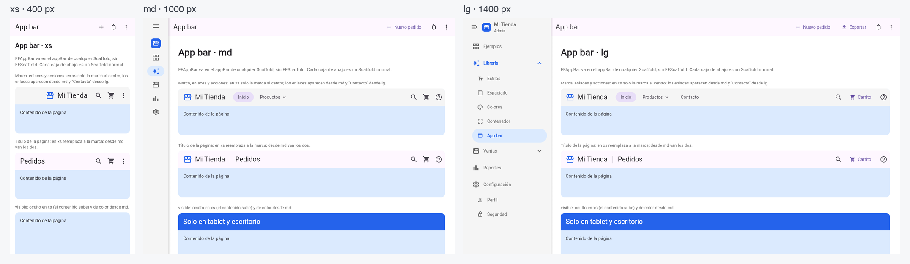

# flow_frame

Tools for building responsive Flutter interfaces with a Bootstrap-like approach: mobile-first breakpoints, reusable styles, light and dark colors, and navigation that adapts to the screen width.



## Features

| | What it does | |
|---|---|---|
| [Breakpoints](#breakpoints) | `xs` `sm` `md` `lg` `xl`, mobile-first | |
| [`FFValue`](#ffvalue-a-value-per-breakpoint) | A cascading value per breakpoint | |
| [`FFSpacing`](#ffspacing-padding-and-margin) | Padding and margin per breakpoint | [image](#ffspacing-padding-and-margin) |
| [`FFStyle`](#ffstyle-reusable-styles) | CSS-class-like reusable styles: text, color, size, visibility | [image](#ffstyle-reusable-styles) |
| [Colors](#colors-and-dark-mode) | `FFColor` with light and dark variants | [image](#colors-and-dark-mode) |
| [`FFContainer`](#ffcontainer) | Centered container with a maximum width | [image](#ffcontainer) |
| [`FFFlex` and `FFItem`](#ffflex-and-ffitem) | A 12-column grid with rows or columns that adapt per breakpoint | [image](#ffflex-and-ffitem) |
| [`FFScaffold`](#ffscaffold-breakpoint-based-navigation) | Bottom bar, rail, sidebar, drawer, or app bar links based on screen width | [GIF](#ffscaffold-breakpoint-based-navigation) |
| [`FFBrand`](#ffscaffold-breakpoint-based-navigation) | App logo and name next to ☰ | |
| [`FFAppBar`](#ffappbar-standalone-app-bar) | A standalone responsive app bar for any `Scaffold`: branding, title, links, actions, and breakpoint-based visibility | [image](#ffappbar-standalone-app-bar) |
| [`FFActions`](#ffactions-app-bar-actions) | App bar actions with text, icons only, in the ⋮ menu, or hidden | [image](#ffactions-app-bar-actions) |

## Installation

```yaml
dependencies:
  flow_frame:
    git:
      url: https://github.com/jgilpragma23/flow_frame.git
      ref: v0.0.11
```

```dart
import 'package:flow_frame/flow_frame.dart';
```

Import only the capability you need when you do not want the complete API:

```dart
import 'package:flow_frame/responsive.dart'; // Breakpoints and FFValue
import 'package:flow_frame/grid.dart';       // FFFlex and FFItem
import 'package:flow_frame/colors.dart';     // FFColor
import 'package:flow_frame/containers.dart'; // FFContainer
import 'package:flow_frame/styling.dart';    // FFStyle and FFStyled
import 'package:flow_frame/navigation.dart'; // Navigation and app bars
```

`flow_frame.dart` remains the convenience import that combines these
capabilities. The grid and container widgets do not require `FFStyle`; use
`FFStyled` or `FFStyledItem` only when style composition is desired.

Styling is also split by concern: `FFTextStyle` handles typography,
`FFDecorationStyle` handles colors, borders and shadows, and `FFLayoutStyle`
handles spacing, size and visibility. Use just one, or compose them with
`FFStyle.compose`:

```dart
final cardStyle = FFStyle.compose(
  text: FFTextStyle(color: FFColor.fixed(Colors.blue)),
  decoration: FFDecorationStyle(
    backgroundColor: FFValue(xs: FFColor.fixed(Color(0xFFE3F2FD))),
  ),
  layout: FFLayoutStyle(
    padding: FFSpacing(all: FFValue.all(16)),
  ),
);
```

Apply components directly to a subtree with `FFStyled`, or to a grid column
with `FFStyledItem.compose`:

```dart
FFFlex(
  children: [
    FFStyledItem.compose(
      col: const FFValue(xs: 12, md: 6),
      decoration: const FFDecorationStyle(
        backgroundColor: FFValue(xs: FFColor.fixed(Color(0xFFE3F2FD))),
      ),
      child: const Text('Blue column'),
    ),
  ],
)
```

## Complete example

The example is a multi-screen catalog of Flow Frame's capabilities. Open the
Library section to explore breakpoints, the grid, styles, typography, spacing,
colors, themes, containers, navigation, and the standalone app bar. The theme
action switches between light and dark mode so you can see `FFColor.adaptive`
update live. The app shell is in [`example/lib/main.dart`](example/lib/main.dart);
the topic pages are in [`example/lib/demos.dart`](example/lib/demos.dart).

```dart
class AppColors {
  static const surface = FFColor.adaptive(light: Color(0xFFF5F5F5), dark: Color(0xFF1E1E1E));
  static const primary = FFColor.adaptive(light: Color(0xFF2563EB), dark: Color(0xFF60A5FA));
  static const primarySoft = FFColor.adaptive(light: Color(0xFFDBEAFE), dark: Color(0xFF1E3A5F));
  static const muted = FFColor.adaptive(light: Color(0xFF666666), dark: Color(0xFF9E9E9E));
}

const card = FFStyle(
  padding: FFSpacing(all: FFValue(xs: 12, md: 20)),
  backgroundColor: FFValue(xs: AppColors.surface),
);

class Shell extends StatefulWidget {
  const Shell({super.key});

  @override
  State<Shell> createState() => _ShellState();
}

class _ShellState extends State<Shell> {
  String _route = 'sales/orders';

  @override
  Widget build(BuildContext context) {
    return FFScaffold(
      currentRoute: _route,
      onRouteSelected: (id) => setState(() => _route = id),
      destinations: const [
        FFDestination(id: 'home', icon: Icon(Icons.home_outlined), label: 'Home'),
        FFDestination(
          id: 'sales',
          icon: Icon(Icons.storefront_outlined),
          label: 'Sales',
          children: [
            FFDestination(id: 'sales/orders', icon: Icon(Icons.receipt_long_outlined), label: 'Orders'),
            FFDestination(id: 'sales/customers', icon: Icon(Icons.people_outline), label: 'Customers'),
          ],
        ),
        FFDestination(
          id: 'reports',
          icon: Icon(Icons.bar_chart_outlined),
          label: 'Reports',
          visible: FFValue(xs: false, md: true), // Does not fit in the bottom bar.
        ),
      ],
      // Bottom bar on phones, rail on tablets, and sidebar on desktop.
      responsive: const FFValue(
        xs: FFNavStyle(
          type: FFNavigationEnum.bottom,
          selectedIconColor: AppColors.primary,
          selectedBackgroundColor: AppColors.primarySoft,
        ),
        md: FFNavStyle(type: FFNavigationEnum.rail, shadow: true),
        lg: FFNavStyle(expandMode: FFRailExpandEnum.sidebar, expanded: true),
      ),
      brand: const FFBrand(
        logo: Icon(Icons.storefront),
        title: Text('My Store'),
        subtitle: Text('Admin'),
      ),
      appBar: FFAppBar(
        title: const Text('Orders'),
        actions: [
          FFAction(
            icon: const Icon(Icons.add),
            label: 'New order',
            onPressed: () {},
            display: const FFValue(xs: FFActionDisplayEnum.icon, md: FFActionDisplayEnum.full),
          ),
          FFAction(
            icon: const Icon(Icons.download_outlined),
            label: 'Export',
            onPressed: () {},
            display: const FFValue(xs: FFActionDisplayEnum.menu, lg: FFActionDisplayEnum.full),
          ),
        ],
      ),
      body: const OrdersPage(),
    );
  }
}

class OrdersPage extends StatelessWidget {
  const OrdersPage({super.key});

  @override
  Widget build(BuildContext context) {
    return SingleChildScrollView(
      child: FFContainer(
        maxSize: 1280,
        child: FFStyled(
          style: const FFStyle(padding: FFSpacing(all: FFValue(xs: 16, md: 32))),
          child: FFFlex(
            gap: const FFValue(xs: 16, md: 24),
            children: [
            // Summary: 1 per row on xs, 2 on sm, and 4 from lg onward.
            FFFlex(
              gap: const FFValue(xs: 12, md: 16),
              children: [
                for (final (title, value) in [
                  ('Today', '24'),
                  ('This week', '183'),
                  ('Pending', '7'),
                  ('Revenue', '\$4.2k'),
                ])
                  FFStyledItem(
                    col: const FFValue(xs: 12, sm: 6, lg: 3),
                    style: card,
                    child: Text('$value  $title'),
                  ),
              ],
            ),
            // List and details: stacked on xs/sm, side by side from md onward.
            FFFlex(
              direction: const FFValue(
                xs: FFDirectionEnum.vertical,
                md: FFDirectionEnum.horizontal,
              ),
              gap: const FFValue(xs: 12, md: 16),
              children: [
                const FFStyledItem(
                  col: FFValue(md: 7, xl: 8),
                  style: card,
                  child: OrdersList(),
                ),
                FFStyledItem(
                  fill: const FFValue(md: true),
                  visible: const FFValue(xs: false, md: true),
                  style: card.merge(
                    const FFStyle(
                      backgroundColor: FFValue(xs: AppColors.primarySoft),
                    ),
                  ),
                  child: const OrderDetails(),
                ),
              ],
            ),
          ],
        ),
      ),
    );
  }
}
```

The same screen in dark mode, with no code changes (`FFColor` selects a variant based on the `Theme`):



### Run the example

```bash
cd example && flutter run -d chrome
```

The **Library** menu has a page for each topic (styles, spacing, colors, and containers); these pages are the source of the images in this README. Resize the window to see how each element adapts.

## Breakpoints

| Name | From (px) | Typical use |
|---|---|---|
| `xs` | 0 | Phone |
| `sm` | 600 | Landscape phone / small tablet |
| `md` | 840 | Tablet |
| `lg` | 1200 | Desktop |
| `xl` | 1600 | Large screen |

The breakpoint is determined by the screen width.

```dart
if (context.breakpoint >= BreakpointEnum.md) { ... }
```

The default thresholds are `600 / 840 / 1200 / 1600` logical pixels. Wrap an
app or a subtree in `FFBreakpointScope` to customize its thresholds. Nested
scopes can use different values independently:

```dart
FFBreakpointScope(
  breakpoints: const FFBreakpoints(sm: 640, md: 900, lg: 1200, xl: 1600),
  child: MaterialApp(home: const MyApp()),
)
```

## `FFValue`: a value per breakpoint

Each value applies from its breakpoint upward until another value overrides it (mobile-first).

```dart
const gap = FFValue(xs: 8, md: 16); // 8 on xs/sm, 16 on md/lg/xl
const fill = FFValue(md: true);     // null on xs/sm, true from md onward
const same = FFValue.all(12);       // 12 at every breakpoint

gap.resolve(context.breakpoint);
context.responsive(xs: 1, md: 2, xl: 4); // shorthand
```

## `FFSpacing`: padding and margin



```dart
const FFSpacing(
  all: FFValue(xs: 8, md: 16, xl: 24),
  horizontal: FFValue(lg: 32),
  vertical: FFValue(sm: 12),
  top: FFValue(md: 20),
)
```

For each side:
1. The closest defined breakpoint wins.
2. If tied, the most specific value wins: side (`top`) over axis (`vertical`), and axis over `all`.

In the example above, `top` is 8 on `xs`, 12 on `sm`, 20 on `md` and `lg`, and 24 on `xl`.

## `FFStyle`: reusable styles



It works like a CSS class. Every property is optional.

```dart
const card = FFStyle(
  padding: FFSpacing(all: FFValue(xs: 12, md: 16)),
  margin: FFSpacing(bottom: FFValue(xs: 8)),

  // Text: textStyle is the base; the other properties override it.
  textStyle: FFValue(
    xs: TextStyle(fontSize: 14, fontFamily: 'Inter'),
    md: TextStyle(fontSize: 16),
  ),
  color: AppColors.text,
  fontWeight: FFValue(md: FontWeight.w600),
  fontSize: FFValue(xl: 18),
  lineHeight: FFValue(xs: 1.4),
  textAlign: FFValue(xs: TextAlign.center, md: TextAlign.start),

  backgroundColor: FFValue(xs: AppColors.surface, lg: AppColors.primarySoft),
  backgroundImage: FFValue(
    xs: DecorationImage(image: AssetImage('assets/fondo_movil.jpg'), fit: BoxFit.cover),
    md: DecorationImage(image: AssetImage('assets/fondo.jpg'), fit: BoxFit.cover),
  ),
  shadow: FFValue(xs: FFShadow.sm, md: FFShadow.lg), // Like shadow-sm / shadow-lg.
  borderRadius: FFValue(
    xs: BorderRadius.all(Radius.circular(8)),
    md: BorderRadius.vertical(top: Radius.circular(16)), // Top only.
  ),
  borderWidth: FFValue(xs: 1),
  borderColor: AppColors.border, // Defaults to the theme's outlineVariant.

  width: FFValue(md: 480),
  minWidth: FFValue(md: 320),
  maxWidth: FFValue(lg: 640),
  height: FFValue(md: 200),
  maxHeight: FFValue(xs: 240, lg: 400),

  visible: FFValue(xs: false, md: true), // Like d-none d-md-block.
  clip: FFValue(xs: true), // Like overflow: hidden.
);
```

- **`textStyle` is merged cumulatively:** at `md`, the `TextStyle`s from `xs`, `sm`, and `md` are combined, with the largest breakpoint taking precedence for each property. In the example, the `Inter` font defined at `xs` is retained at `md`.
- **`color`, `fontWeight`, `fontSize`, and `lineHeight` override `textStyle`.** `color` is separate because `TextStyle` does not account for dark mode.
- **`shadow`** accepts a `List<BoxShadow>` per breakpoint. `FFShadow` provides `sm`, `md`, and `lg` (Bootstrap-like values), plus `none` to remove the shadow at a larger breakpoint. The shadow surrounds the background and padding.
- **`backgroundColor`** is an `FFValue<FFColor>`: it changes per breakpoint, and each color adapts to light or dark mode.
- **`backgroundImage`** accepts a `DecorationImage` per breakpoint (image, `fit`, `alignment`, opacity, etc.) and is painted over `backgroundColor`. This lets you use a lighter image on mobile.
- **`borderRadius`** accepts a Flutter `BorderRadius` per breakpoint, so each corner can be configured independently: `BorderRadius.all`, `.vertical(top: ...)`, `.horizontal(left: ...)`, `.only(...)`, or `BorderRadiusDirectional` (start and end, for RTL). It rounds the background, shadow, and border, and clips the content to that shape, so an image without padding gets rounded corners. Use `BorderRadius.all(Radius.circular(12))` instead of `BorderRadius.circular(12)` so the style can be `const`.
- **`borderWidth`** is drawn inside the box and added to the padding so the content does not sit underneath the border.
- **`maxHeight` limits height but does not add scrolling:** taller content overflows. For a list or long text, put a `ListView` or `SingleChildScrollView` inside:

```dart
FFStyled(
  style: const FFStyle(maxHeight: FFValue(xs: 240, lg: 400)),
  child: ListView(shrinkWrap: true, children: [...]),
)
```

- **`clip`** clips overflowing content, like `overflow: hidden`. Content uses its natural height, and anything beyond `height` or `maxHeight` is clipped without Flutter's overflow warning. It follows the `borderRadius` corners inside the border:

```dart
FFStyledItem(
  style: const FFStyle(
    maxHeight: FFValue(xs: 120),
    borderRadius: FFValue(xs: BorderRadius.all(Radius.circular(12))),
    clip: FFValue(xs: true),
  ),
  child: Image.network(url, fit: BoxFit.cover),
)
```

  Do not use it with a scrollable child (`ListView`): scrollables already clip and need a fixed height.
- **`merge`** combines two styles; the second takes precedence where it defines a value:

```dart
final hiddenCard = card.merge(const FFStyle(visible: FFValue(xs: false, lg: true)));
```

### Text

For a standalone text widget, `toTextStyle(context)` returns a regular Flutter `TextStyle`:

```dart
Text('Title', style: title.toTextStyle(context))
TextField(style: title.toTextStyle(context))
```

For multiple text widgets, apply the style to a container and its child `Text` widgets inherit it:

```dart
FFStyled(
  style: const FFStyle(
    textStyle: FFValue(xs: TextStyle(fontSize: 14)),
    color: AppColors.muted,
  ),
  child: Column(
    children: [
      const Text('Line 1'),                                // Inherits the container style.
      Text('Title', style: title.toTextStyle(context)),    // Inherits it; title overrides its own properties.
    ],
  ),
)
```

`toTextStyle` only includes properties defined by that style, so it combines with the container's style. `TextField` does not inherit a container's text style (that is how Flutter works); apply `toTextStyle` directly to it.

### Resolved values

`resolve(context)` returns an `FFResolvedStyle` containing standard Flutter values (`EdgeInsets`, `TextStyle`, `Color`, etc.) that can be used with any widget:

```dart
final s = card.resolve(context);
Padding(padding: s.padding, child: ...)
```

## Colors and dark mode



The package has no built-in theme or palette: define colors in your own code. An `FFColor` can have light and dark variants:

```dart
FFColor.adaptive(light: Color(0xFFFFF7E6), dark: Color(0xFF3A2E14))
FFColor.fixed(Color(0xFFFFFFFF)) // Does not change.
```

It is practical to group them in a class and use them in styles:

```dart
class AppColors {
  static const surface = FFColor.adaptive(light: Color(0xFFF5F5F5), dark: Color(0xFF1E1E1E));
  static const text = FFColor.adaptive(light: Color(0xFF111111), dark: Color(0xFFF5F5F5));
  static const muted = FFColor.adaptive(light: Color(0xFF666666), dark: Color(0xFF9E9E9E));
  static const primary = FFColor.adaptive(light: Color(0xFF2563EB), dark: Color(0xFF60A5FA));
  static const primarySoft = FFColor.adaptive(light: Color(0xFFDBEAFE), dark: Color(0xFF1E3A5F));
}

const card = FFStyle(backgroundColor: FFValue(xs: AppColors.surface), color: AppColors.text);
```

Outside a style, `resolve` returns the `Color` for the current mode:

```dart
Scaffold(backgroundColor: AppColors.surface.resolve(context))
```

Light or dark mode is read from the app's `Theme`, so it follows your `MaterialApp.themeMode` without any extra setup.

## `FFContainer`



It uses the available width up to `maxSize` and centers on wider screens.
Style it separately by wrapping it in `FFStyled`.

```dart
FFStyled(
  style: const FFStyle(
    padding: FFSpacing(horizontal: FFValue(xs: 16, md: 24)),
  ),
  child: FFContainer(maxSize: 1280, child: ...),
)
```

Without `maxSize`, it uses the full available width.

## `FFFlex` and `FFItem`

`FFFlex` is like a Bootstrap `row`: it distributes 12 columns and wraps items that do not fit onto the next row. Each item is an `FFItem`. It can also be vertical at all or selected breakpoints.

### Grid: rows that adapt automatically



It is horizontal by default: each child specifies how much space it uses, and anything that does not fit wraps to the next row.

```dart
FFFlex(
  gap: const FFValue.all(16), // Between items and rows.
  children: [
    for (final p in products)
      FFItem(col: const FFValue(xs: 12, md: 6, lg: 4), child: ProductCard(p)),
  ],
)
```

| Breakpoint | `col` | Result with 5 products |
|---|---|---|
| `xs`, `sm` | 12 | 1 per row, 5 rows |
| `md` | 6 | 2 per row: 1-2, 3-4, 5 |
| `lg`, `xl` | 4 | 3 per row: 1-2-3, 4-5 |

Each child can be sized in three ways:

| `FFItem` | Width | Bootstrap equivalent |
|---|---|---|
| `col: FFValue(md: 6)` | 6 of 12 columns | `col-md-6` |
| `fill: FFValue(md: true)` | Remaining space in its row | `col` |
| `fill: FFValue(md: false)` | Natural size | `col-auto` |
| Neither | Full row | Child of `.row` without `col` |

Since a child without `col` occupies the full row, an `FFFlex` with children that have no `col` stacks them vertically. This works for a page, form, or list of sections without any additional configuration.

You can mix them in the same row:

```dart
FFFlex(
  gap: const FFValue.all(16),
  children: [
    FFItem(col: const FFValue(xs: 12, md: 3), child: Filters()),
    FFItem(fill: const FFValue.all(true), child: OrderSearch()),
    FFItem(
      fill: const FFValue.all(false), // Natural size.
      child: IconButton(icon: const Icon(Icons.tune), onPressed: () {}),
    ),
  ],
)
```

A common example: an image next to text on phones, and stacked vertically from `md` onward:

```dart
FFFlex(
  children: [
    FFItem(col: const FFValue(xs: 4, md: 12), child: ImageWidget()),
    FFItem(col: const FFValue(xs: 8, md: 12), child: TextWidget()),
  ],
)
```

At `md`, all three fit in one row: filters use 3/12 columns, the icon takes its natural size, and the search field uses the remaining space. At `xs`, the filters use the full row, while the search field and icon wrap onto the next row.

If an `FFItem` has both `col` and `fill`, the value defined at the closest breakpoint wins. With `col: FFValue(xs: 12)` and `fill: FFValue(md: true)`, it takes the full row on `xs`/`sm` and the remaining space from `md` onward. If both are defined at the same breakpoint, `col` wins.

### Vertical layout

With `direction: FFDirectionEnum.vertical`, items are stacked, use the full width, and `col` is ignored. Use it when height matters:

- `fill` distributes the remaining height, like `Expanded` in a `Column` (only when `FFFlex` has a bounded height).
- `mainAxisAlignment` aligns vertically, for example centering a login screen or pushing a footer to the bottom.
- With `crossAxisAlignment: center`, naturally sized items are stacked and centered horizontally.

```dart
FFFlex(
  direction: const FFValue.all(FFDirectionEnum.vertical),
  children: [
    const Header(),
    FFItem(fill: const FFValue.all(true), child: ListView(...)), // Takes the remaining height.
    const BotonGuardar(),
  ],
)
```

The direction can also change per breakpoint, for example `FFValue(xs: FFDirectionEnum.vertical, md: FFDirectionEnum.horizontal)`.

### Reverse the order

`FFDirectionEnum` has four values, similar to Bootstrap classes:

| `FFDirectionEnum` | Bootstrap | Result |
|---|---|---|
| `horizontal` (default) | `flex-row` | 12-column rows |
| `horizontalReverse` | `flex-row-reverse` | Same, with children in reverse order |
| `vertical` | `flex-column` | Stacked from top to bottom |
| `verticalReverse` | `flex-column-reverse` | Stacked from bottom to top |

For example, show an image on the left on phones and on the right from `md` onward:

```dart
FFFlex(
  direction: const FFValue(xs: FFDirectionEnum.horizontal, md: FFDirectionEnum.horizontalReverse),
  children: [
    FFItem(col: const FFValue(xs: 4), child: ImageWidget()),
    FFItem(col: const FFValue(xs: 8), child: TextWidget()),
  ],
)
```

The entire list is reversed: in a row, the last child moves to the left; when stacked, it moves to the top. `order` is applied before reversing. Reversing does not cause items to lose their state.

### Reference

**`FFFlex`**
- `direction`: an `FFDirectionEnum` per breakpoint: `horizontal` (default), `horizontalReverse`, `vertical`, or `verticalReverse`.
- `gap`: spacing between items and, in horizontal layouts, between rows.
- `mainAxisAlignment`: defaults to `start`. In horizontal layouts, it applies to each row.
- `crossAxisAlignment`: defaults to `stretch` in vertical layouts (items use the full width) and `start` in horizontal layouts. In horizontal layouts, it applies within each row; `stretch` makes items match the row height.
- `children`: can be `FFItem`s or any widgets. In a horizontal layout, a widget that is not an `FFItem` occupies the full row.

**`FFItem`**
- `col`: how many of the 12 columns it occupies (1 to 12). Horizontal layouts only. Without `col` or `fill`, it occupies the full row.
- `fill`: `true` uses the remaining space in its row; if multiple items have it, they split that space equally. `false` uses its natural size (`col-auto`). It can change per breakpoint, for example `FFValue(xs: false, sm: true, lg: false)`.
- `order`: position within `FFFlex`; lower values come first (defaults to 0).
- `visible`: whether the item participates in the layout at each breakpoint; hidden items leave no gap.

**Details:**
- Each child is laid out once, like in a `Row` or `Wrap`, so this is no more expensive than those widgets. As with them, all children are built even when not visible; for lists with hundreds of items, consider `GridView.builder`.
- If `FFFlex` has an unbounded constraint along its main axis (for example, a vertical layout inside a `SingleChildScrollView`), `fill` and `col` are ignored instead of causing an error.
- Changing `order` or hiding an item does not make other items lose their state.
- Respects `TextDirection.rtl`.
- `FFItem` contains layout properties only. Use `FFStyled` for arbitrary widget subtrees or `FFStyledItem` to combine an `FFItem` with `FFStyle`.

## `FFScaffold`: breakpoint-based navigation

It works like a `Scaffold` (accepting `appBar`, `body`, `floatingActionButton`, `floatingActionButtonLocation`, and `backgroundColor`), and also builds navigation based on the breakpoint. `appBar` can be an `AppBar` or an [`FFAppBar`](#ffappbar-standalone-app-bar).



```dart
class Home extends StatefulWidget {
  const Home({super.key});

  @override
  State<Home> createState() => _HomeState();
}

class _HomeState extends State<Home> {
  String _route = 'home';

  @override
  Widget build(BuildContext context) {
    return FFScaffold(
      appBar: AppBar(title: const Text('My app')),
      currentRoute: _route,
      onRouteSelected: (id) => setState(() => _route = id),
      destinations: const [
        FFDestination(id: 'home', icon: Icon(Icons.home_outlined), label: 'Home'),
        FFDestination(
          id: 'sales',
          icon: Icon(Icons.storefront_outlined),
          label: 'Sales',
          children: [
            FFDestination(id: 'sales/orders', icon: Icon(Icons.receipt_long_outlined), label: 'Orders'),
            FFDestination(id: 'sales/customers', icon: Icon(Icons.people_outline), label: 'Customers'),
          ],
        ),
        // Visible from md onward only.
        FFDestination(
          id: 'reports',
          icon: Icon(Icons.bar_chart_outlined),
          label: 'Reports',
          visible: FFValue(xs: false, md: true),
        ),
        // Always-open group, with no arrow.
        FFDestination(
          id: 'settings',
          icon: Icon(Icons.settings_outlined),
          label: 'Settings',
          alwaysOpen: true,
          children: [
            FFDestination(id: 'settings/profile', icon: Icon(Icons.person_outline), label: 'Profile'),
          ],
        ),
      ],

      // Each breakpoint defines only what changes; the rest is inherited.
      responsive: const FFValue(
        xs: FFNavStyle(
          type: FFNavigationEnum.bottom,
          backgroundColor: AppColors.surface,
          iconColor: AppColors.muted,
          labelColor: AppColors.muted,
          selectedBackgroundColor: AppColors.primarySoft,
          selectedIconColor: AppColors.primary,
          selectedLabelColor: AppColors.primary,
        ),
        md: FFNavStyle(type: FFNavigationEnum.rail, expandMode: FFRailExpandEnum.overlay),
        lg: FFNavStyle(expandMode: FFRailExpandEnum.sidebar, expanded: true),
      ),

      body: pages[_route]!,
    );
  }
}
```

| Breakpoint | With the example above |
|---|---|
| `xs`, `sm` | Bottom bar with the `xs` colors; Reports is hidden |
| `md` | Icon rail; ☰ opens the full menu over the content |
| `lg`, `xl` | Full menu open as a sidebar, pushing the content |

**`FFNavStyle`**

| Field | What it does |
|---|---|
| `type` | `FFNavigationEnum.bottom`, `rail`, `drawer`, or `appBar` |
| `expandMode` | For a rail, how the full menu opens: `FFRailExpandEnum.overlay` or `sidebar` |
| `expanded` | Whether the menu starts open when using `sidebar` |
| `subRoutesAlwaysVisible` | Keep all groups open, with no arrow |
| `backgroundColor` | Background of the bar, rail, and menu; for `appBar`, the app bar background if it has none |
| `iconColor`, `labelColor` | Unselected icons and labels |
| `selectedBackgroundColor` | Background of the selected destination |
| `selectedIconColor`, `selectedLabelColor` | Icon and label of the selected destination |
| `shadow` | Shadow separating navigation from content: on the right of the rail and sidebar, and above the bar. Disabled by default |
| `shadowColor` | Shadow color; defaults to a subtle color based on light or dark mode |

- `responsive` cascades like `FFStyle`: `lg` in the example remains a `rail` and uses the colors from `xs`.
- Colors are `FFColor`, so they adapt automatically to dark mode. Any unspecified colors use the `Theme` values.
- Unspecified settings come from `FFScaffold.defaults`: bottom bar on `xs`/`sm`, rail with `overlay` on `md`, and an open `sidebar` from `lg` onward.

**Navigation types (`FFNavigationEnum`)**
- `bottom`: bottom bar with icons and labels (`NavigationBar`).
- `rail`: fixed icon rail with a ☰ button at the top to open the full menu (icons, labels, and subroutes).
- `drawer`: hidden menu that slides in from the side when ☰ is tapped in the app bar; it closes when a destination is selected. If you do not provide an `appBar`, an empty one is added to provide the button.
- `appBar`: links inside the app bar, after the title, like on a website. A group is a button with ▾ that opens a dropdown containing its subroutes. Intended for `md` and wider screens: on narrow screens, overflowing links scroll horizontally. Your `AppBar` keeps its title, `leading`, and `actions`; if you pass another `PreferredSizeWidget`, links appear in a strip below.

```dart
responsive: const FFValue(
  xs: FFNavStyle(type: FFNavigationEnum.bottom),
  md: FFNavStyle(type: FFNavigationEnum.appBar),
),
```

**How the menu opens from the rail (`FFRailExpandEnum`)**
- `overlay`: the menu appears over the content, like a drawer, with a dark backdrop. It closes when a destination is selected or the backdrop is tapped.
- `sidebar`: the rail expands and pushes the content. It remains open until closed with ☰.

**Subroutes (`children`)**
- A destination with `children` is a group, not a page. Groups support one level of nesting.
- In the full menu (sidebar, overlay, and drawer), groups appear as accordions. The group containing the current route opens automatically.
- `alwaysOpen: true` keeps a group open with no arrow; it takes precedence over `subRoutesAlwaysVisible`.
- In the app bar, each group is a dropdown containing its subroutes.
- The bottom bar and collapsed rail show only groups. Tapping a group in the bottom bar navigates to its last visited subroute (or the first one). Tapping a group in the collapsed rail opens the menu with that group expanded.

**Destinations per breakpoint**
- `visible: FFValue(...)` hides a destination or subroute at the specified breakpoints. A group with no visible subroutes is hidden.

**Branding: logo and name next to ☰**

```dart
FFScaffold(
  brand: FFBrand(
    logo: Image.asset('assets/logo.png'),
    title: const Text('My Store'),
    subtitle: const Text('Admin'),       // Optional; shown only in the menu.
    onTap: () => context.go('/'),        // Optional.
  ),
  ...
)
```

Define it once; each navigation type positions it accordingly:

| Navigation | Position |
|---|---|
| sidebar and overlay | `☰ [logo] My Store / Admin` in the menu header |
| collapsed rail | Logo only, below ☰ |
| drawer | `☰ [logo] My Store` in the app bar, and full branding at the top of the drawer (`showInDrawer: false` removes it there) |
| appBar | `[logo] My Store` before the links |
| bottom | `[logo] My Store` in the app bar |

In the app bar, branding is used only if the `AppBar` has no `title`; the app bar's own title takes precedence. The logo is sized to 28 px (32 in the rail and at the top of the drawer).

**Open the menu from code**
- `FFScaffold.of(context)` provides `openMenu()`, `closeMenu()`, `toggleMenu()`, and `isMenuOpen`. These work with the rail and drawer.

**Details**
- Use one navigation type per breakpoint.
- The rail and sidebar span the full screen height from the top. The `appBar` appears only above the content, alongside the rail or sidebar, and ☰ aligns with its title. The overlay appears above everything, including the app bar.
- If the user opens or closes the menu with ☰, that choice is retained while they remain at the same breakpoint. When the breakpoint changes, the menu returns to the `expanded` value.
- The current route (`currentRoute`) does not change when the navigation type changes.

## `FFActions`: app bar actions



Each action can show an icon and text, an icon only, appear in the ⋮ menu, or be hidden at each breakpoint. Use it in `AppBar.actions` (with or without `FFScaffold`) or in any row.

```dart
AppBar(
  title: const Text('Orders'),
  actions: [
    FFActions(
      actions: [
        FFAction(
          icon: const Icon(Icons.add),
          label: 'New order',
          onPressed: _create,
          display: const FFValue(xs: FFActionDisplayEnum.icon, md: FFActionDisplayEnum.full),
        ),
        FFAction(
          icon: const Icon(Icons.download_outlined),
          label: 'Export',
          onPressed: _export,
          display: const FFValue(xs: FFActionDisplayEnum.menu, lg: FFActionDisplayEnum.full),
        ),
        FFAction(
          icon: const Icon(Icons.print_outlined),
          label: 'Print',
          onPressed: _print,
          display: const FFValue(xs: FFActionDisplayEnum.hidden, md: FFActionDisplayEnum.menu),
        ),
      ],
    ),
  ],
)
```

| | New order | Export | Print |
|---|---|---|---|
| `xs`, `sm` | Icon | In ⋮ | Hidden |
| `md` | Icon and text | In ⋮ | In ⋮ |
| `lg`, `xl` | Icon and text | Icon and text | In ⋮ |

**`FFActionDisplayEnum`**
- `full`: icon and text, like a button.
- `icon`: icon only; the text is used as a tooltip.
- `menu`: in the ⋮ menu, with icon and text.
- `hidden`: not shown.

**Detalles**
- `display` cascades. Without `display`, the action appears with its icon only.
- The ⋮ appears only if an action uses `menu` at the current breakpoint. `menuIcon` and `menuTooltip` customize its icon and tooltip.
- `onPressed: null` displays the action as disabled.

## `FFAppBar`: standalone app bar



A responsive app bar for the `appBar` of any `Scaffold`, without `FFScaffold`. Use it when you already have your own layout (for example, with go_router) and only want the app bar to adapt to the screen width.

```dart
Scaffold(
  appBar: FFAppBar(
    brand: const FFBrand(logo: Icon(Icons.storefront), title: Text('My Store')),
    title: const Text('Orders'),
    destinations: links,              // Optional: links and dropdown groups.
    currentRoute: 'home',
    onRouteSelected: (id) => context.go('/$id'),
    actions: [
      FFAction(icon: const Icon(Icons.search), label: 'Search', onPressed: _search),
      FFAction(
        icon: const Icon(Icons.shopping_cart),
        label: 'Cart',
        onPressed: _openCart,
        display: const FFValue(xs: FFActionDisplayEnum.icon, lg: FFActionDisplayEnum.full),
      ),
    ],
    responsive: const FFValue(
      xs: FFAppBarStyle(showBrand: false, centerTitle: true),
      md: FFAppBarStyle(showBrand: true, centerTitle: false),
    ),
  ),
  body: ...,
)
```

| Parameter | Description |
|---|---|
| `brand` | App logo and name, at the beginning |
| `title` | After the branding, separated by a divider. For example, the page name |
| `actions` | `FFAction`s that adapt per breakpoint, as in [`FFActions`](#ffactions-app-bar-actions) |
| `trailing` | Widgets after the actions, such as an avatar |
| `destinations`, `currentRoute`, `onRouteSelected` | Links after the title, with dropdown groups. Respects `FFDestination.visible`. Links are hidden if `onRouteSelected` is not provided |
| `leading`, `automaticallyImplyLeading`, `bottom`, `toolbarHeight` | Same as in `AppBar` |
| `responsive` | Cascading `FFValue<FFAppBarStyle>` |

**`FFAppBarStyle`**

| Property | What it changes |
|---|---|
| `visible` | `false` hides the entire app bar and moves the content up |
| `showBrand`, `showTitle` | `false` hides the branding or title |
| `centerTitle` | Centers the branding and title. Defaults to left-aligned on all platforms; with links, they always remain left-aligned |
| `backgroundColor`, `foregroundColor` | Background; title and icon colors (`FFColor`) |
| `elevation` | Shadow |
| `linkColor`, `selectedLinkColor`, `selectedLinkBackgroundColor` | Link colors and the current route's link colors |

**Inside `FFScaffold`**

When passed as the `appBar` of an `FFScaffold`, it inherits any properties you do not define:
- The scaffold's branding, if `FFAppBar` has neither `brand` nor `title`, and navigation is not a rail.
- With `FFNavigationEnum.appBar`, the destinations and route for the links, and the navigation background.
- Link colors from `FFNavStyle`.

Values set in `responsive` always take precedence. If you hide the app bar with `visible: false` while using drawer navigation, ☰ is hidden as well.
