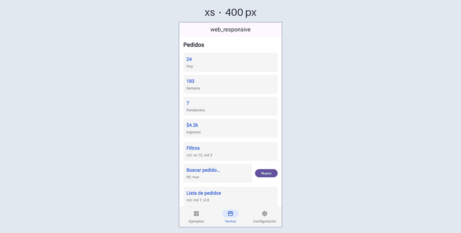

# web_responsive

Herramientas para hacer interfaces responsive en Flutter con una idea parecida a Bootstrap: breakpoints mobile-first, estilos reutilizables y colores que cambian con el modo claro u oscuro.

> En desarrollo. Ya están los breakpoints, `WRValue`, `WRSpacing`, `WRStyle`, los colores con modo oscuro, `WRContainer`, `WRFlex`, `WRItem` y `WRScaffold`.

## Ejemplo completo

```dart
WRContainer(
  maxSize: 1280,
  style: const WRStyle(padding: WRSpacing(horizontal: WRValue(xs: 16, md: 24))),
  child: WRFlex(
    // Sidebar arriba en móvil, a la izquierda desde md
    direction: const WRValue(xs: Axis.vertical, md: Axis.horizontal),
    gap: const WRValue(xs: 16, md: 24),
    children: [
      WRItem(
        style: const WRStyle(
          width: WRValue(md: 280),
          visible: WRValue(xs: false, sm: true),
        ),
        child: Sidebar(),
      ),
      WRItem(fill: const WRValue(md: true), child: Content()),
    ],
  ),
)
```

## Breakpoints

| Nombre | Desde (px) | Uso típico |
|---|---|---|
| `xs` | 0 | Teléfono |
| `sm` | 600 | Teléfono horizontal / tablet pequeña |
| `md` | 840 | Tablet |
| `lg` | 1200 | Escritorio |
| `xl` | 1600 | Pantalla grande |

El breakpoint se calcula con el ancho de la pantalla.

```dart
if (context.breakpoint >= Breakpoint.md) { ... }
```

Para cambiar las medidas, asígnalas una vez antes de `runApp`:

```dart
void main() {
  WRBreakpoints.current = const WRBreakpoints(sm: 600, md: 900, lg: 1200, xl: 1600);
  runApp(const MyApp());
}
```

## `WRValue`: un valor por breakpoint

Cada valor aplica desde su breakpoint hacia arriba hasta que otro lo reemplace (mobile-first).

```dart
const gap = WRValue(xs: 8, md: 16); // 8 en xs/sm, 16 en md/lg/xl
const fill = WRValue(md: true);     // null en xs/sm, true desde md
const same = WRValue.all(12);       // 12 en todos

gap.resolve(context.breakpoint);
context.responsive(xs: 1, md: 2, xl: 4); // atajo
```

## `WRSpacing`: padding y margin

```dart
const WRSpacing(
  all: WRValue(xs: 8, md: 16, xl: 24),
  horizontal: WRValue(lg: 32),
  vertical: WRValue(sm: 12),
  top: WRValue(md: 20),
)
```

Para cada lado:
1. Gana el breakpoint más cercano al actual.
2. Si empatan, gana el más específico: el lado (`top`) sobre el eje (`vertical`), y el eje sobre `all`.

Con el ejemplo de arriba, el `top` vale 8 en `xs`, 12 en `sm`, 20 en `md` y `lg`, y 24 en `xl`.

## `WRStyle`: estilos reutilizables

Funciona como una clase de CSS. Todo es opcional.

```dart
const card = WRStyle(
  padding: WRSpacing(all: WRValue(xs: 12, md: 16)),
  margin: WRSpacing(bottom: WRValue(xs: 8)),

  // Texto: textStyle es la base, lo demás va encima
  textStyle: WRValue(
    xs: TextStyle(fontSize: 14, fontFamily: 'Inter'),
    md: TextStyle(fontSize: 16),
  ),
  color: AppColors.text,
  fontWeight: WRValue(md: FontWeight.w600),
  fontSize: WRValue(xl: 18),
  lineHeight: WRValue(xs: 1.4),
  textAlign: WRValue(xs: TextAlign.center, md: TextAlign.start),

  backgroundColor: AppColors.surface,

  width: WRValue(md: 480),
  minWidth: WRValue(md: 320),
  maxWidth: WRValue(lg: 640),
  height: WRValue(md: 200),

  visible: WRValue(xs: false, md: true), // como d-none d-md-block
);
```

- **`textStyle` se combina en cascada:** en `md` se juntan los `TextStyle` de `xs`, `sm` y `md`, y en cada propiedad gana el mayor. En el ejemplo, la fuente `Inter` definida en `xs` se mantiene en `md`.
- **`color`, `fontWeight`, `fontSize` y `lineHeight` ganan sobre `textStyle`.** `color` va aparte porque un `TextStyle` no sabe del modo oscuro.
- **`merge`** combina dos estilos; el segundo gana donde define algo:

```dart
final hiddenCard = card.merge(const WRStyle(visible: WRValue(xs: false, lg: true)));
```

### Texto

Para un texto suelto, `toTextStyle(context)` devuelve un `TextStyle` normal de Flutter:

```dart
Text('Título', style: title.toTextStyle(context))
TextField(style: title.toTextStyle(context))
```

Para varios textos, pon el estilo en un contenedor y los `Text` de adentro lo heredan:

```dart
WRContainer(
  style: const WRStyle(
    textStyle: WRValue(xs: TextStyle(fontSize: 14)),
    color: AppColors.muted,
  ),
  child: Column(
    children: [
      const Text('Línea 1'),                               // hereda
      Text('Título', style: title.toTextStyle(context)),   // hereda y title cambia lo suyo
    ],
  ),
)
```

`toTextStyle` solo trae lo que define ese estilo, por eso se combina con lo del contenedor. `TextField` no hereda el estilo del contenedor (así funciona Flutter); usa `toTextStyle` con él.

### Todos los valores calculados

`resolve(context)` devuelve un `WRResolvedStyle` con valores normales de Flutter (`EdgeInsets`, `TextStyle`, `Color`, etc.) para usar con cualquier widget:

```dart
final s = card.resolve(context);
Padding(padding: s.padding, child: ...)
```

## Colores y modo oscuro

La librería no tiene tema ni paleta propia: los colores se definen en tu código. Un `WRColor` puede tener versión clara y oscura:

```dart
WRColor.adaptive(light: Color(0xFFFFF7E6), dark: Color(0xFF3A2E14))
WRColor.fixed(Color(0xFFFFFFFF)) // no cambia
```

Lo práctico es juntarlos en una clase y usarlos en los estilos:

```dart
class AppColors {
  static const surface = WRColor.adaptive(light: Color(0xFFF5F5F5), dark: Color(0xFF1E1E1E));
  static const text = WRColor.adaptive(light: Color(0xFF111111), dark: Color(0xFFF5F5F5));
  static const muted = WRColor.adaptive(light: Color(0xFF666666), dark: Color(0xFF9E9E9E));
  static const primary = WRColor.adaptive(light: Color(0xFF2563EB), dark: Color(0xFF60A5FA));
  static const primarySoft = WRColor.adaptive(light: Color(0xFFDBEAFE), dark: Color(0xFF1E3A5F));
}

const card = WRStyle(backgroundColor: AppColors.surface, color: AppColors.text);
```

Fuera de un estilo, `resolve` devuelve el `Color` del modo actual:

```dart
Scaffold(backgroundColor: AppColors.surface.resolve(context))
```

El modo claro u oscuro se lee del `Theme` de la app, así que sigue al `themeMode` de tu `MaterialApp` sin configurar nada.

## `WRContainer`

Ocupa todo el ancho hasta `maxSize` y se centra en pantallas más anchas. El `style` se aplica por dentro de ese ancho.

```dart
WRContainer(
  maxSize: 1280,
  style: const WRStyle(
    padding: WRSpacing(horizontal: WRValue(xs: 16, md: 24)),
  ),
  child: ...,
)
```

Sin `maxSize` ocupa todo el ancho.

## `WRFlex` y `WRItem`

`WRFlex` es una fila o columna que cambia por breakpoint (como `d-flex flex-column flex-md-row`). `WRItem` es cada elemento.

### Grilla: filas que se acomodan solas

En horizontal, `WRFlex` funciona como un `row` de Bootstrap: cada hijo dice cuánto ocupa y lo que no cabe baja a la siguiente fila.

```dart
WRFlex(
  direction: const WRValue.all(Axis.horizontal),
  gap: const WRValue.all(16), // entre elementos y entre filas
  children: [
    for (final p in products)
      WRItem(col: const WRValue(xs: 12, md: 6, lg: 4), child: ProductCard(p)),
  ],
)
```

| Breakpoint | `col` | Resultado con 5 productos |
|---|---|---|
| `xs`, `sm` | 12 | 1 por fila, 5 filas |
| `md` | 6 | 2 por fila: 1-2, 3-4, 5 |
| `lg`, `xl` | 4 | 3 por fila: 1-2-3, 4-5 |

Cada hijo puede medirse de tres formas:

| `WRItem` | Ancho | En Bootstrap |
|---|---|---|
| `col: WRValue(md: 6)` | 6 de 12 columnas | `col-md-6` |
| `fill: WRValue(md: true)` | Lo que sobra en su fila | `col` |
| Ninguno | Su tamaño natural | `col-auto` |

Se pueden mezclar en la misma fila:

```dart
WRFlex(
  direction: const WRValue.all(Axis.horizontal),
  gap: const WRValue.all(16),
  children: [
    WRItem(col: const WRValue(xs: 12, md: 3), child: Filtros()),
    WRItem(fill: const WRValue.all(true), child: Buscador()),
    IconButton(icon: const Icon(Icons.tune), onPressed: () {}),
  ],
)
```

En `md` van los tres en una fila: filtros en 3/12, el ícono con su tamaño y el buscador con el resto. En `xs` los filtros ocupan la fila completa y el buscador y el ícono bajan a la siguiente.

Si un `WRItem` tiene `col` y `fill`, gana el que esté definido en el breakpoint más cercano al actual. Con `col: WRValue(xs: 12)` y `fill: WRValue(md: true)`: fila completa en `xs`/`sm` y lo que sobra desde `md`. Si están en el mismo breakpoint, gana `col`.

### Vertical

En vertical los elementos se apilan. Por defecto ocupan todo el ancho, `col` se ignora y `fill` reparte la altura que sobra (solo si el `WRFlex` tiene un alto limitado).

```dart
WRFlex(
  direction: const WRValue(xs: Axis.vertical, md: Axis.horizontal),
  gap: const WRValue(xs: 12, md: 16),
  children: [
    WRItem(fill: const WRValue(md: true), style: card, child: Card1()),
    WRItem(fill: const WRValue(md: true), style: card, child: Card2()),
    WRItem(
      order: const WRValue(xs: -1, md: 0), // primero en móvil, en su lugar desde md
      child: Image(...),
    ),
  ],
)
```

### Referencia

**`WRFlex`**
- `direction`: por defecto vertical.
- `gap`: separación entre elementos y, en horizontal, también entre filas.
- `mainAxisAlignment`: por defecto `start`. En horizontal se aplica a cada fila.
- `crossAxisAlignment`: por defecto `stretch` en vertical (los elementos ocupan todo el ancho) y `start` en horizontal. En horizontal se aplica dentro de cada fila; `stretch` iguala la altura de la fila.
- `style`: un `WRStyle` para el contenedor.
- `children`: pueden ser `WRItem` o cualquier widget (este toma su tamaño natural).

**`WRItem`**
- `col`: cuántas de las 12 columnas ocupa (de 1 a 12). Solo en horizontal.
- `fill`: `true` hace que ocupe el espacio que sobra en su fila; si varios lo tienen, se lo reparten en partes iguales. `false` o sin valor: toma su tamaño natural. Puede cambiar por breakpoint, por ejemplo `WRValue(xs: false, sm: true, lg: false)`.
- `order`: posición dentro del `WRFlex`; los menores van primero (por defecto 0).
- `style`: un `WRStyle`. Con `visible: false` el elemento se quita y no deja separación.

**Detalles:**
- Cada hijo se mide una vez, como en un `Row` o un `Wrap`, así que no pesa más que ellos. Como ellos, construye todos sus hijos aunque no se vean; para listas de cientos de elementos conviene `GridView.builder`.
- Si el `WRFlex` no tiene un límite en su eje (por ejemplo, vertical dentro de un `SingleChildScrollView`), `fill` y `col` se ignoran en vez de dar error.
- Cambiar `order` o ocultar un elemento no hace perder el estado de los demás.
- Respeta `TextDirection.rtl`.
- Fuera de un `WRFlex`, `WRItem` ignora `col`, `fill` y `order` y solo aplica su `style`. Sirve como un `div` con clases.

## `WRScaffold`: navegación según el breakpoint

Funciona como un `Scaffold` (recibe `appBar`, `body`, `floatingActionButton`, `floatingActionButtonLocation` y `backgroundColor`), pero además arma la navegación según el breakpoint.



```dart
class Home extends StatefulWidget {
  const Home({super.key});

  @override
  State<Home> createState() => _HomeState();
}

class _HomeState extends State<Home> {
  String _route = 'inicio';

  @override
  Widget build(BuildContext context) {
    return WRScaffold(
      appBar: AppBar(title: const Text('Mi app')),
      currentRoute: _route,
      onRouteSelected: (id) => setState(() => _route = id),
      destinations: const [
        WRDestination(id: 'inicio', icon: Icon(Icons.home_outlined), label: 'Inicio'),
        WRDestination(
          id: 'ventas',
          icon: Icon(Icons.storefront_outlined),
          label: 'Ventas',
          children: [
            WRDestination(id: 'ventas/pedidos', icon: Icon(Icons.receipt_long_outlined), label: 'Pedidos'),
            WRDestination(id: 'ventas/clientes', icon: Icon(Icons.people_outline), label: 'Clientes'),
          ],
        ),
        // Solo desde md
        WRDestination(
          id: 'reportes',
          icon: Icon(Icons.bar_chart_outlined),
          label: 'Reportes',
          visible: WRValue(xs: false, md: true),
        ),
        // Grupo siempre abierto, sin flecha
        WRDestination(
          id: 'config',
          icon: Icon(Icons.settings_outlined),
          label: 'Configuración',
          alwaysOpen: true,
          children: [
            WRDestination(id: 'config/perfil', icon: Icon(Icons.person_outline), label: 'Perfil'),
          ],
        ),
      ],

      // Cada breakpoint pone solo lo que cambia; el resto lo hereda
      responsive: const WRValue(
        xs: WRNavStyle(
          type: WRNavigation.bottom,
          backgroundColor: AppColors.surface,
          iconColor: AppColors.muted,
          labelColor: AppColors.muted,
          selectedBackgroundColor: AppColors.primarySoft,
          selectedIconColor: AppColors.primary,
          selectedLabelColor: AppColors.primary,
        ),
        md: WRNavStyle(type: WRNavigation.rail, expandMode: WRRailExpand.overlay),
        lg: WRNavStyle(expandMode: WRRailExpand.sidebar, expanded: true),
      ),

      body: pages[_route]!,
    );
  }
}
```

| Breakpoint | Con el ejemplo de arriba |
|---|---|
| `xs`, `sm` | Barra abajo con los colores de `xs`, sin Reportes |
| `md` | Rail de íconos; ☰ abre el menú completo encima del contenido |
| `lg`, `xl` | Menú completo abierto como sidebar, que empuja el contenido |

**`WRNavStyle`**

| Campo | Qué hace |
|---|---|
| `type` | `WRNavigation.bottom`, `rail`, `drawer` o `appBar` |
| `expandMode` | Con rail, cómo se abre el menú completo: `WRRailExpand.overlay` o `sidebar` |
| `expanded` | Con `sidebar`, si el menú empieza abierto |
| `subRoutesAlwaysVisible` | Todos los grupos siempre abiertos, sin flecha |
| `backgroundColor` | Fondo de la barra, el rail y el menú; con `appBar`, fondo del app bar si este no tiene uno |
| `iconColor`, `labelColor` | Íconos y textos sin seleccionar |
| `selectedBackgroundColor` | Fondo del destino seleccionado |
| `selectedIconColor`, `selectedLabelColor` | Ícono y texto del destino seleccionado |

- `responsive` funciona en cascada, como `WRStyle`: `lg` del ejemplo sigue siendo `rail` y usa los colores de `xs`.
- Los colores son `WRColor`, así que cambian solos en modo oscuro. Los que no pongas usan los del `Theme`.
- Lo que no definas sale de `WRScaffold.defaults`: barra abajo en `xs`/`sm`, rail con `overlay` en `md` y `sidebar` abierto desde `lg`.

**Tipos de navegación (`WRNavigation`)**
- `bottom`: barra abajo con íconos y textos (`NavigationBar`).
- `rail`: barra lateral de íconos con un botón ☰ arriba que abre el menú completo (íconos, textos y subrutas).
- `drawer`: menú oculto que sale desde el lado al tocar ☰ en el app bar; se cierra al elegir una opción. Si no pasas `appBar`, se pone uno vacío para que exista el botón.
- `appBar`: enlaces dentro del app bar, después del título, como en un sitio web. Un grupo es un botón con ▾ que abre un dropdown con sus subrutas. Pensado para `md` en adelante: en pantallas angostas los enlaces que no caben se desplazan de lado. Tu `AppBar` conserva su título, `leading` y `actions`; si pasas otro `PreferredSizeWidget`, los enlaces van en una franja debajo.

```dart
responsive: const WRValue(
  xs: WRNavStyle(type: WRNavigation.bottom),
  md: WRNavStyle(type: WRNavigation.appBar),
),
```

**Cómo se abre el menú desde el rail (`WRRailExpand`)**
- `overlay`: el menú sale encima del contenido, como un drawer, con fondo oscuro. Se cierra al elegir una opción o al tocar fuera.
- `sidebar`: el rail se ensancha y empuja el contenido. Queda abierto hasta cerrarlo con ☰.

**Subrutas (`children`)**
- Un destino con `children` es un grupo: no es una página, solo agrupa. Un solo nivel.
- En el menú completo (sidebar, overlay y drawer) se muestra como acordeón. El grupo que tiene la ruta actual se abre solo.
- `alwaysOpen: true` deja ese grupo abierto y sin flecha; tiene prioridad sobre `subRoutesAlwaysVisible`.
- En el app bar, cada grupo es un dropdown con sus subrutas.
- En la barra abajo y en el rail cerrado solo se ven los grupos. En la barra, tocar un grupo lleva a su última subruta visitada (o a la primera). En el rail cerrado, abre el menú con ese grupo desplegado.

**Destinos por breakpoint**
- `visible: WRValue(...)` oculta un destino o una subruta en los breakpoints que digas. Un grupo sin subrutas visibles se oculta.

**Abrir el menú desde código**
- `WRScaffold.of(context)` da `openMenu()`, `closeMenu()`, `toggleMenu()` e `isMenuOpen`. Sirve para el rail y el drawer.

**Detalles**
- Se usa un solo tipo por breakpoint.
- Si el usuario abre o cierra el menú con ☰, se respeta mientras siga en el mismo breakpoint. Al cambiar de breakpoint vuelve al valor de `expanded`.
- La ruta actual (`currentRoute`) no cambia al cambiar de navegación.
